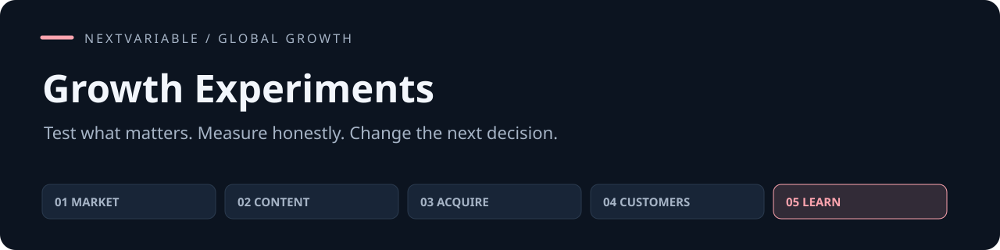

# Growth Experiments

**增长实验执行与复盘 · 把增长猜想变成可执行的验证，再用数据、成本与风险决定继续、扩大、修改还是停止。**

[](https://github.com/NextVariable/global-growth-experiments-skill/actions/workflows/validate.yml) [](LICENSE) [](https://agentskills.io/specification)

[快速开始](#quick-start) · [任务示例](examples/first-task.md) · [方法](#method) · [验证](#validation) · [五个 Skill 合集](https://github.com/NextVariable/global-growth-skills)

输入 **当前投入决定、已有数据、候选改动、预算、时间与可用工具**，得到 **验证方案、测量口径、执行交接、结果解释和下一步决定**。可以独立使用；已有项目资料或其他 Skill 的交接都能直接接入。指令以中文编写，对客产物按目标受众选择语言。

## In practice

> 成熟样本从 24/60 到 33/60：40%→55%，增加 15 个百分点，相对增加 37.5%。预设安全停止线已触发，应停止新版继续暴露。
>
> 不把尚未成熟的各 40 家当失败，也不用 p>0.05 证明安全；低流量时用真实任务观察排除障碍。

以上是合成任务的结果节选。[查看输入和完整任务说明 →](examples/first-task.md)

## Quick start

在你的项目目录运行，选择要安装到的客户端：

```sh
npx skills add NextVariable/global-growth-experiments-skill --skill global-growth-experiments
```

需要跨项目使用时加 `-g`。此安装方式需要 Node.js 22.20+；也可以直接复制技能目录。

<details>
<summary>手动安装到 Codex（Git；已有目录时停止）</summary>

```sh
git clone https://github.com/NextVariable/global-growth-experiments-skill.git
cd global-growth-experiments-skill
mkdir -p "$HOME/.agents/skills"
target="$HOME/.agents/skills/global-growth-experiments"
if [ -e "$target" ] || [ -L "$target" ]; then
  echo "Already exists: $target"
else
  cp -R skills/global-growth-experiments "$target"
fi
```

完整保留 `skills/global-growth-experiments/` 内的方法、模板和许可。已有同名目录时先保存旧版及个人修改，再比较版本；不要把两份目录直接合并。其他客户端使用其配置的 Skill 目录。

</details>

重新加载客户端后调用 `$global-growth-experiments`。方法通过客户端工具工作；可选计算/状态脚本使用 Python 3.10+ 标准库。

```text
使用 $global-growth-experiments。
产品与当前阶段：……
这次要解决：……
已确认的能力、材料和限制：……
可投入的时间、预算与人员：……
请完成我需要的产物；未知的关键条件明确说明。
```

项目资料保存在你自己的工作目录，安装包只放通用方法。实际外发、发布、支出或客户系统操作依赖相应工具和授权。

## Method

入口只保留任务判断和必要边界，按需加载相关方法，不要求每次读完或跑完整个流程。

| 方法 | 解决什么 |
|---|---|
| [实验设计](skills/global-growth-experiments/references/experiment-design.md) | 选择关键未知、证据方式、分配单位与决策条件 |
| [测量与数据](skills/global-growth-experiments/references/measurement.md) | 事件、分母、窗口、去重、成熟与数据质量 |
| [执行与恢复](skills/global-growth-experiments/references/execution.md) | 操作包、上线核验、护栏、变更与回退 |
| [复盘与回流](skills/global-growth-experiments/references/learning.md) | 不确定性、成本、投入决定与下一动作 |

需要核对两组转化计数时，可直接运行：

```sh
python3 skills/global-growth-experiments/scripts/conversion_summary.py --control 24 60 --variant 33 60
```

计算器提供描述性比例、百分点差、相对变化和各组 Wilson 区间，不自动宣布胜负。

## Validation

```sh
PYTHONDONTWRITEBYTECODE=1 python3 scripts/validate.py
```

[验证说明](validation/README.md)区分结构与记录检查、计算测试、模型任务和真实业务结果。自动检查不替代语义审阅；合成试用不能证明获客、收入或留存提升。客户端实际加载、目标用户理解和业务效果应在自己的环境验证。

## Ecosystem

[01 市场战略](https://github.com/NextVariable/global-gtm-strategy-skill) → [02 定位内容](https://github.com/NextVariable/global-growth-content-skill) → [03 发布获客](https://github.com/NextVariable/global-launch-acquisition-skill) → [04 客户增长](https://github.com/NextVariable/global-sales-retention-skill) → [05 实验复盘](https://github.com/NextVariable/global-growth-experiments-skill)

五个独立仓库，按当前问题选用。共享产品背景、证据与版本，结果可以回到前面的决策；其他四个不是安装依赖。

## Contributing

改进建议请带一个具体任务、期望结果和实际问题。开发、检查与提交方式见 [CONTRIBUTING.md](CONTRIBUTING.md)；功能问题可提交 [Issue](https://github.com/NextVariable/global-growth-experiments-skill/issues/new/choose)。

## English

Choose a meaningful growth experiment, coordinate execution, validate measurement and make the next investment decision. Supports both randomized tests and useful low-traffic learning. Install the complete skill directory and invoke `$global-growth-experiments`. Instructions are Chinese-first; deliverables follow the target audience. Model and external tools are supplied by your client.

[MIT](LICENSE). 安装和再分发时保留随包许可文件。
